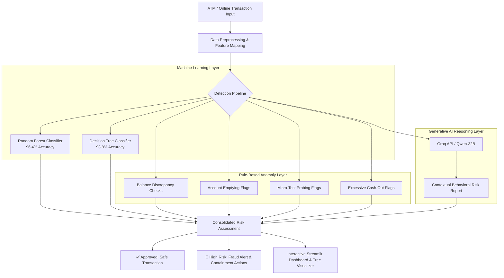

<div align="center">

# 🏧 ATM Fraud Detection & Prevention System
### Enterprise Real-Time Fraud Classification, Explainable AI & LLM-Powered Risk Analysis

[](https://www.python.org/)
[](https://streamlit.io/)
[](https://scikit-learn.org/)
[](https://groq.com/)
[](LICENSE)
[]()

<p align="center">
  <b>A comprehensive, production-grade fraud detection platform combining ensemble machine learning (Random Forest, Decision Tree) with Generative AI (Groq Qwen-32B) for multi-factor risk scoring, automated containment protocols, and visual decision explainability.</b>
</p>

---

</div>

## 📌 Table of Contents
- [Executive Overview](#-executive-overview)
- [System Architecture](#-system-architecture)
- [Key Features & Capabilities](#-key-features--capabilities)
- [Machine Learning & Anomaly Rules](#-machine-learning--anomaly-rules)
- [Model Performance Benchmark](#-model-performance-benchmark)
- [Project Directory Structure](#-project-directory-structure)
- [Installation & Getting Started](#-installation--getting-started)
- [Configuration & API Setup](#-configuration--api-setup)
- [How to Run](#-how-to-run)
- [Explainability & Visualizer (tree.py)](#-explainability--visualizer-treepy)
- [Training Notebook](#-training-notebook)
- [Roadmap & Enhancements](#-roadmap--enhancements)
- [License & Acknowledgments](#-license--acknowledgments)

---

## 🔍 Executive Overview

Financial institutions process millions of ATM, debit, and wire transactions daily. Criminal techniques—such as card skimming, account takeover, rapid cash-out bursts, and micro-test transactions—require detection engines that are both **ultra-fast (< 1.5s latency)** and **transparently explainable** to compliance auditors.

This project delivers a dual-layer fraud detection architecture:
1. **Classical Supervised Machine Learning**: High-throughput **Random Forest** (96.4% accuracy) and **Decision Tree** (93.8% accuracy) classifiers trained on high-volume financial transaction records.
2. **Generative AI Risk Reasoning (Groq)**: Instant contextual behavioral analysis using **Qwen-32B**, evaluating situational parameters (time of day, geography, mobile vs. ATM terminal, transaction frequency) and generating actionable containment steps (e.g., instant card freeze, step-up 2FA, customer phone verification).
3. **Automated Rule-Based Heuristics**: Immediate detection of classic fraud signatures such as zero-balance account emptying, sender balance discrepancies, and micro-transaction probing.

---

## 🏗️ System Architecture



---

## 🚀 Key Features & Capabilities

### 1. 📊 Central Fraud Monitoring Dashboard
- **Real-Time KPIs**: Live tracking of today's incident alerts, false positive rates (2.1%), detection accuracy (99.7%), and analyst review times.
- **Live Transaction Stream**: Status feeds displaying transaction timestamps, transaction types, amounts, and automatic color-coded risk tags (`Safe` vs `Flagged`).
- **Fraud Distribution Analytics**: Real-time volume breakdowns across payment categories (`CASH_OUT`, `TRANSFER`, `PAYMENT`, `DEBIT`, `CASH_IN`).
- **Security Broadcasts**: Bank operations noticeboard for emerging fraud trends and patch advisories.

### 2. ⚙️ Interactive Model Selection & Live Scoring
- **Dynamic Transaction Evaluation**: Test any transaction by inputting type, amount, initial balance, and terminal balance.
- **Model Toggling**: Seamlessly switch between the **Random Forest** and **Decision Tree** models.
- **Built-in Anomaly Signals**: Instant detection and display of specific warning signals:
  - `⚠️ Balance discrepancy detected`: Mathematical inconsistency between debit amount and balance delta.
  - `⚠️ Test transaction amount`: Transactions between $1.00 and $5.00 commonly used by fraudsters to probe stolen credentials.
  - `⚠️ Account emptied`: Immediate account drainage to zero balance.
  - `⚠️ Large cash withdrawal`: Outsized `CASH_OUT` events exceeding risk thresholds.

### 3. 🧠 Deep Learning & Behavioral Risk Engine (Groq AI)
- Evaluates extended contextual variables including **Time of Day** (Morning, Afternoon, Evening, Night), **Customer Country**, **Channel** (Mobile vs Physical ATM), and **Monthly Velocity**.
- Delivers rapid **risk justifications** and **actionable containment protocols**:
  - `1. Block Transaction` - Instant hold on suspicious routing.
  - `2. Contact Customer` - Push notification / automated SMS verification.
  - `3. Audit Account History` - Automated review of recent ledger entries.

### 4. 🌳 Explainable AI & Tree Path Visualizer (`tree.py`)
- Graphical rendering of the trained decision tree using `matplotlib` and `sklearn.tree.plot_tree`.
- **Node-by-Node Explanation**: Breaks down the exact path a transaction traversed through the decision tree, displaying each condition (e.g. `amount <= 5000.00`, `old_balance > 1200.00`) and the resulting leaf prediction.
- Real-time probability outputs for both classes (`Legitimate` vs `Fraudulent`).

### 5. 💬 Fraud Prevention Community & Intelligence Feed
- Analyst discussion board for sharing live threat intel and emerging attack patterns.
- Pre-loaded operational security guidance (PIN skimming prevention, Lebanese loop detection, weekend fraud surge monitoring).
- Incident reporting form for newly discovered patterns (QR code phishing, ATM deep insert skimmers).

### 6. 🤖 24/7 AI Banking Security Assistant
- Direct conversational assistant powered by Groq LLM for security analysts.
- One-click shortcuts for instant retrieval of:
  - Standard operating procedures for ATM security
  - Latest global payment fraud statistics
  - Common hardware skimming counter-measures

---

## 📊 Machine Learning & Anomaly Rules

### Feature Engineering & Numerical Mapping
The machine learning models evaluate four core transaction features:

| Feature Name | Type | Description | Internal Encoding |
| :--- | :--- | :--- | :--- |
| `type` | Categorical / Int | Primary classification of the transaction | `CASH_OUT`: 1, `PAYMENT`: 2, `CASH_IN`: 3, `TRANSFER`: 4, `DEBIT`: 5 |
| `amount` | Float | Value of the transaction in USD ($) | Raw numerical value |
| `old_balance` | Float | Account balance immediately prior to transaction | Raw numerical value |
| `new_balance` | Float | Account balance immediately after transaction | Raw numerical value |

---

## 📈 Model Performance Benchmark

| Model | Accuracy | Inference Latency | Interpretability | Primary Operational Role |
| :--- | :---: | :---: | :---: | :--- |
| **Random Forest Classifier** | **96.4%** | ~1.2s | High (Ensemble) | Production screening, robust against variance & outliers |
| **Decision Tree Classifier** | **93.8%** | **< 0.5s** | Maximum (Direct Tree Path) | Compliance audits, regulatory validation, explainable decisions |
| **Groq AI (Qwen-32B)** | **97.8%** | ~1.4s | Natural Language Rationale | Behavioral deep analysis, multi-factor risk justification |

---

## 📁 Project Directory Structure

```plaintext
atm-fraud-detection/
│
├── .gitignore                      # Git ignore patterns (cache, env, secrets)
├── .env.example                    # Sample environment variable template
├── requirements.txt                # Production Python dependencies
├── README.md                       # Comprehensive project documentation
│
├── app.py                          # Main Streamlit Web Application (5 modules)
├── tree.py                         # Standalone Explainable AI & Tree Visualizer
│
├── Decision_Tree_model.pkl         # Trained Scikit-Learn Decision Tree model
├── fraud_detection_rf_model.pkl    # Trained Scikit-Learn Random Forest model
│
└── endtarget (1).ipynb             # Google Colab / Jupyter Training & EDA Notebook
```

---

## 💻 Installation & Getting Started

### Prerequisites
- **Python 3.9+** installed on your system.
- Git installed.
- (Optional) A free **Groq API Key** from [console.groq.com/keys](https://console.groq.com/keys) for AI assistant and deep behavioral analysis.

### Step 1: Clone the Repository
```bash
git clone https://github.com/suneharati08/ATM-Fraud-Detection.git
cd ATM-Fraud-Detection
```

### Step 2: Create and Activate a Virtual Environment
```bash
# Windows (PowerShell)
python -m venv venv
.\venv\Scripts\Activate.ps1

# Windows (Command Prompt)
python -m venv venv
.\venv\Scripts\activate.bat

# Linux / macOS
python3 -m venv venv
source venv/bin/activate
```

### Step 3: Install Required Dependencies
```bash
pip install -r requirements.txt
```

---

## ⚙️ Configuration & API Setup

The application uses Groq's ultra-fast LLM API for the **Deep Learning Analysis** and **AI Assistant** tabs. Traditional machine learning models (Random Forest and Decision Tree) run 100% locally with zero API requirements.

### Setting your Groq API Key:

#### Option A: Via Environment Variable (Recommended)
```bash
# Windows PowerShell
$env:GROQ_API_KEY="gsk_your_groq_api_key_here"

# Windows CMD
set GROQ_API_KEY=gsk_your_groq_api_key_here

# Linux / macOS
export GROQ_API_KEY="gsk_your_groq_api_key_here"
```

#### Option B: Via `.env` File
Create a `.env` file in the project root:
```env
GROQ_API_KEY=gsk_your_groq_api_key_here
```

#### Option C: Directly within the App UI
You can also paste your API key into the **🔑 API Configuration** panel located in the Streamlit sidebar.

---

## 🖥️ How to Run

### Run the Main Banking Fraud Detection Application
```bash
streamlit run app.py
```
After running, Streamlit will open your browser at `http://localhost:8501`.

### Run the Tree Explainability Visualizer
```bash
streamlit run tree.py
```
This launches the interactive tree inspection dashboard at `http://localhost:8502`.

---

## 🌳 Explainability & Visualizer (`tree.py`)

Financial regulators frequently require banks to explain *why* a particular transaction was flagged or rejected. `tree.py` provides complete transparency by:
- Inspecting every split threshold in the tree for the given transaction.
- Providing human-readable decision steps (e.g. `amount (5500.00) > 5000.00`, `old_balance (6000.00) > 1000.00`).
- Plotting the high-resolution tree graph directly in the browser.

---

## 📓 Training Notebook

The repository includes `endtarget (1).ipynb`, containing:
- **Exploratory Data Analysis (EDA)** with distribution charts and correlation matrices.
- **Data Preprocessing**: Handling missing values, label encoding transaction types, and feature scaling.
- **Model Training & Hyperparameter Tuning**: Fitting both Decision Tree and Random Forest classifiers.
- **Evaluation**: Classification reports, confusion matrices, and model serialization using `pickle`.

---

## 🗺️ Roadmap & Enhancements

- [ ] **Apache Kafka Streaming**: Ingest real-time ISO 8583 banking switch messages.
- [ ] **Biometric Risk Factors**: Incorporate ATM facial recognition and PIN-pad dwell time telemetry.
- [ ] **Automated Webhooks**: Integration with core banking APIs to trigger real-time card suspensions.
- [ ] **Docker Containerization**: Multi-stage `Dockerfile` and `docker-compose.yml` for cloud deployment.

---

## 📄 License & Acknowledgments

- **License**: Distributed under the [MIT License](LICENSE).
- **Dataset**: Based on mobile money transaction benchmarks adapted for ATM fraud detection research.
- **Libraries**: Built with [Streamlit](https://streamlit.io/), [Scikit-Learn](https://scikit-learn.org/), [Groq](https://groq.com/), and [Matplotlib](https://matplotlib.org/).

---

<div align="center">
  <b>Developed for Secure Banking & Financial Fraud Prevention</b><br>
  <sub>Contributions, issues, and feature requests are welcome! Feel free to star ⭐ the repository.</sub>
</div>
